# ai-second-brain-harness

Illustrative, AI-generated.

A second brain for an AI coding agent (Claude Code or Codex). It gives the agent a fixed place
to keep what you teach it, and a fixed way to find that knowledge again in a later session.

## What it does for you

- **You teach it once.** When you say "remember this" or "add this process", the agent files the
  item in one home, with the source that it came from.
- **It finds it again.** In a new session, the agent reads a short boot card, finds the matching
  file, and uses it. It does not read every file.
- **It keeps a record.** At the end of each session, the agent writes what it did in your status
  file, your logs and your memory. The next session starts from that record.
- **It asks before it acts outside.** The agent asks you before it sends, posts, pushes or
  changes anything outside your PC.
- **Your personal data stays on your PC.** Your status, memory and finished work are in folders
  that git ignores. Only the shared rules and knowledge go into the repository.

## How it works

### One session

1. **Ask for a task.** You ask a question or give the agent a job.
2. **Read the rules.** The agent reads `core/boot_card.md` (the short rules and the list of active
   packs) and `core/router.md` (which skill or file fits which request).
3. **Find one file.** The agent opens the index of the matching pack, then only the one file that
   it needs. If nothing matches, it uses the `find-knowledge` skill.
4. **Do the work.** The agent does the task. It asks you before each write outside your PC.
5. **Save new knowledge.** If the session taught something new, the `add-knowledge` skill proposes
   where to file it. It writes the file after your OK.
6. **Record the session.** The `wrap-up` skill runs automatically. It adds one line to
   `local/STATUS.md`, one row to the run ledger, a learning-log entry when useful, and a memory
   update. The next session starts with this record.

### What the agent reads and writes

- **Shared, in git:** `core/` holds the rules, the skills and the scripts. `packs/` holds your
  knowledge, one folder for each subject (a "pack"). Everyone who clones the repository gets these.
- **Only on your PC:** `local/` holds your status, memory, logs, contacts and settings. `work/`
  holds your finished work. Git ignores both folders, so they never leave your PC through a push.

A pack is one subject area, for example "general" or "project management". The `general` pack is
on by default. You turn more packs on in `workspace.yaml`.

### How it keeps knowledge organised

#### Read the smallest file first

The agent does not load everything. It goes from small index files to the one file that it
needs. This is called progressive disclosure.

1. **Boot card** (`core/boot_card.md`): the short rules and the active packs. A script keeps it
   under 50 lines and 4,000 bytes.
2. **Router** (`core/router.md`): which skill or pack fits which kind of request.
3. **Pack index** (`packs/<pack>/INDEX.md`): one row for each file, with its title, type, status
   and date.
4. **One file**, or only the part of a large file that the task needs.
5. **Search, only if steps 1 to 4 find nothing:** `core/scripts/find_knowledge.py` searches the
   titles first, then the text of the files. It is a keyword search.

How we measured (13 Nov 2026): the file sizes on disk. "Stored text" is every Markdown, YAML and
text file in `core/` and `packs/`, plus the root policy files. "One lookup" is `AGENTS.md`, the
boot card, the router, the largest pack index and one knowledge file of median size. The second
pair of bars comes from a private copy of this repository with 5 more packs turned on.

#### How new knowledge gets filed and kept tidy

- **Every item gets one home.** The `add-knowledge` skill puts a new item in one of 9 types: a
  fact, a process, a recipe (how to make one kind of deliverable), a skill, a person, a term, a
  preference, a correction or a status. Then it chooses the pack.
- **No duplicates.** Before it writes, it searches for a file that covers the same item. If one
  exists, it updates that file.
- **Every file has a header.** The header gives the type, the pack, the `source`, the `status`,
  the date when it was true (`valid_from`) and the date for a new check (`review_by`). When a new
  file replaces an old one, the old file is marked `superseded` and points to the new one.
- **Scripts build the indexes.** You never edit an index by hand. `build_indexes.py` builds them
  again from the headers, and `validate.py` checks the rules.
- **Tidy-up asks first.** The `workspace-janitor` skill finds files that are out of date, files
  that stay too long in the inbox, sync-conflict copies and files in the wrong place. It shows a
  list, and it moves files only after you approve the batch.
- **What runs without a question:** the session record at the end of each session (status, run
  log, learning log, memory). To let the agent file new knowledge without your OK too, add a row
  to `local/settings/autonomy.md`.

The diagram sources are in `docs/diagrams/*.html`. Open one in a browser to see it full size.

## Quick start

1. Install Python 3.10 or later, git, and Claude Code or Codex.
2. Clone this repository to a folder that a cloud drive does not sync.
3. Run setup:
   - macOS or Linux: `python3 core/scripts/setup.py`
   - Windows: `py -3 core/scripts/setup.py` (no bash needed)
4. Write your name, pronouns and writing style in `local/settings/owner.md`.
5. Check the install: `python3 core/scripts/validate.py` (on Windows: `py -3 core/scripts/validate.py`).
   It must show PASS.
6. Open the folder in Claude Code or Codex and give it a task.

`BOOTSTRAP.md` has the full guide, with packs, connectors, scheduled checks and updates.

## Layout

| Path | What it holds | Committed |
|---|---|---|
| `AGENTS.md`, `CLAUDE.md` | Master policy (both runtimes) | yes |
| `workspace.yaml` | Active packs, work folders, runtime options | yes |
| `core/policy/` | Approval gates, filing, registries, provenance | yes |
| `core/skills/` | `add-knowledge`, `find-knowledge`, `learning-digest`, `workspace-janitor`, `wrap-up` | yes |
| `core/scripts/` | Build, validate, find, setup | yes |
| `core/registry_rows/` | Core rows for the router and where-to-look | yes |
| `core/router.md`, `core/where_to_look.md`, `core/boot_card.md` | Generated | yes |
| `packs/<name>/` | One domain: `processes/`, `knowledge/`, `recipes/`, `skills/`, `registry_rows/`, `evals/` | yes |
| `packs/general/` | The shipped pack | yes |
| `packs/_template/` | Empty pack to copy | yes |
| `docs/diagrams/`, `docs/images/` | The diagrams (HTML source and SVG) and the picture in this README | yes |
| `BOOTSTRAP.md` | Setup guide | yes |
| `templates/` | Empty forms of the personal files | yes |
| `local/` | All personal state (status, memory, registries, logs, settings) | no |
| `work/` | Deliverables | no |

## Commands

On Windows, use `py -3` in place of `python3`.

| Command | What it does |
|---|---|
| `python3 core/scripts/setup.py` | Copies `templates/` to `local/`, makes `work/` folders, builds indexes |
| `python3 core/scripts/build_indexes.py --write` | Pack indexes, merged registries, skill pointers |
| `python3 core/scripts/build_boot_card.py --write` | Boot card from active packs and recipes |
| `python3 core/scripts/validate.py` | The 5 validator rules, with the personal-data scan |
| `python3 core/scripts/find_knowledge.py <words>` | Search titles, then bodies |
